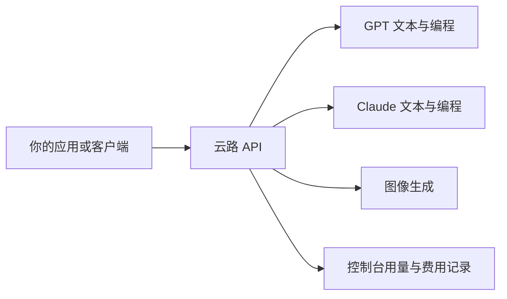

<div align="center">

# 云路 API 接入文档

**GPT · Claude · 图像生成 · 统一接入与用量管理**

[官网](https://yunluapi.com/) · [模型与价格](https://yunluapi.com/pricing) · [控制台](https://yunluapi.com/dashboard) · [使用指南](https://yunluapi.com/guide.html)

</div>

云路 API 为 AI 应用、编程工具和自动化流程提供 GPT、Claude 与图像模型的接入服务。你可以使用云路创建的 API 密钥，在支持自定义地址的客户端或服务端应用中调用模型，并在控制台查看用量与费用。

这个仓库整理公开接入文档、配置示例与排错方法，不包含中转站后台源码、部署配置或用户数据。

## 从这里开始

| 你要做什么 | 直接阅读 |
| --- | --- |
| 发出第一条 API 请求 | [快速开始](QUICKSTART.md) |
| 理解 Responses、Chat Completions 和 Messages 的区别 | [接口与流式调用](API.md) |
| 找到正确的模型 ID | [模型目录](MODELS.md) |
| 配置 Cherry Studio、Claude Code、OpenClaw 或 YunluCodex | [客户端配置](CLIENTS.md) |
| 理解钱包、套餐和密钥额度 | [费用与额度](BILLING.md) |
| 处理 401、404、429、余额不足等问题 | [常见问题](FAQ.md) |
| 检查密钥保存和公开反馈方式 | [密钥安全](SECURITY.md) |

## 一个入口，按协议调用

接入的关键是三个值：**API 地址、云路 API 密钥、完整模型 ID**。模型的网页展示名和请求 ID 可能不同；不同 SDK 也可能自动补上不同的路径。



| 接入方式 | SDK / 客户端地址 | 最终请求路径 |
| --- | --- | --- |
| GPT Responses | `https://api.yunluapi.com/v1` | `/v1/responses` |
| OpenAI 兼容聊天 | `https://api.yunluapi.com/v1` | `/v1/chat/completions` |
| Claude Anthropic Messages | `https://api.yunluapi.com` | `/v1/messages` |

部分客户端会自行添加 `/v1`，此时填写根地址 `https://api.yunluapi.com`。检查最终请求路径，避免出现 `/v1/v1`。图片能力按模型详情和客户端支持范围配置，不要把图像模型填入普通文本示例。[查看接口说明 →](API.md)

## 五分钟完成首次接入

1. 在[官网注册](https://yunluapi.com/sign-up)并完成邮箱验证。
2. 到[钱包](https://yunluapi.com/wallet)确认可用余额或套餐额度。
3. 为当前应用创建[专用 API 密钥](https://yunluapi.com/keys)，设置合适的额度、有效期与模型范围。
4. 在[模型广场](https://yunluapi.com/pricing)复制实际可调用的模型 ID。
5. 发送一条短请求，再去[用量日志](https://yunluapi.com/usage-logs)核对返回状态和费用。

下面是 Python 流式 Responses 的最小示例。先安装 `openai`，并在本机环境变量中设置 `YUNLU_API_KEY`；运行请求会消耗模型额度。

```python
import os
from openai import OpenAI

client = OpenAI(
    api_key=os.environ["YUNLU_API_KEY"],
    base_url="https://api.yunluapi.com/v1",
    max_retries=0,
)

completed = False
with client.responses.create(
    model=os.environ.get("YUNLU_MODEL", "gpt-6-luna"),
    input="请用一句话解释 API。",
    store=False,
    stream=True,
) as stream:
    for event in stream:
        if event.type == "response.output_text.delta":
            print(event.delta, end="", flush=True)
        elif event.type == "response.completed":
            completed = True
        elif event.type in {"response.failed", "response.incomplete", "error"}:
            raise RuntimeError("请求未完整成功，请检查错误事件与用量日志。")

if not completed:
    raise RuntimeError("流提前结束，没有收到完成事件。")
print()
```

`gpt-6-luna` 是本站模型 ID 示例，运行前确认当前账号与密钥有对应权限。环境变量设置、cURL、Node.js 和 Claude 示例见[快速开始](QUICKSTART.md)。

## 可以接入哪些模型

截至 **2026-11-06**，官网公开目录列出 13 个模型条目：8 个 GPT 文本模型、4 个 Claude 模型、1 个图像模型。目录收录不等于每个账号都已获权，实际可用性与价格以登录后的页面为准。

| 类别 | 本站展示范围 | 适用任务 |
| --- | --- | --- |
| GPT 文本 | GPT 5.6、6.0、6.1 系列 | 对话、代码、文档处理与自动化流程 |
| Claude | Fable 5.1、Opus 5.5、Opus 5、Sonnet 5 | 编程、分析、写作与长任务 |
| 图像 | GPT Image 2.0 | 图片创作与视觉设计 |

完整展示名与请求 ID 对照见[模型目录](MODELS.md)。接入时以本站返回的 ID 为准，不自行替换小数点、连字符或版本后缀。

## 从桌面聊天到工作流

**已有聊天客户端。** 在 Cherry Studio 等支持自定义 API 的应用里填入地址与密钥，再获取并启用模型。只获取模型列表，还不代表已经把模型加入聊天界面。[Cherry Studio 教程](https://yunluapi.com/guides/cherry-studio)

**需要 Claude 编程接入。** 选择 Anthropic Messages 协议，填写根地址并使用云路密钥。使用 CC Switch 管理配置时，确认服务商已保存、启用，模型 ID 与账号权限匹配。[Claude 接入说明](https://yunluapi.com/claude-api)

**想直接使用本地助手。** 云路提供 OpenClaw 部署入口，登录后选择系统、模型与密钥上限，在自己的电脑上执行安装步骤。下载的专用脚本包含账号密钥，请只保存在自己的设备上。[OpenClaw 介绍](https://yunluapi.com/openclaw.html)

**把对话延伸到本地项目。** YunluCodex 提供 Windows 客户端：用云路账号聊天、管理会话，也可以选择本地项目文件夹，让模型协助读写代码、运行命令、构建和测试，并查看修改差异。项目能力会将任务所需内容发送给模型，执行环境使用你自己的电脑。[YunluCodex 下载与说明](https://yunluapi.com/portal/yunlucodex/)

## 用量和费用如何管理

控制台把模型调用、API 密钥和用量记录放在同一个账号下。排查“有余额却不能调用”时，需要同时检查钱包余额、套餐适用范围和当前密钥限额，而不是只看其中一项。

- **模型价格：** 在模型广场查看输入、输出、缓存或图像相关的实际计费条件。
- **钱包与套餐：** 套餐有各自适用模型、有效期和额度，不能把某一类专用额度当成全站通用余额。
- **付款金额：** 人民币实付、USD 调用额度与专属套餐的 token 数量是不同单位，以订单明细为准。
- **支付方式：** 以当前钱包和收银台实际展示为准，单次付款支持某种方式不代表自动续费也支持。

本仓库不固定承诺折扣或长期价格，购买前请查看[钱包](https://yunluapi.com/wallet)和[费用说明](BILLING.md)。

## 常见接入问题

| 现象 | 先检查什么 |
| --- | --- |
| 401 / 鉴权失败 | 是否使用云路密钥、是否过期或带多余空格 |
| 404 / 路径错误 | SDK 是否重复拼接 `/v1`、协议是否选对 |
| 余额或额度不足 | 钱包、套餐范围、密钥独立限额 |
| 模型不可用 | 完整 ID、密钥模型权限、当前服务状态 |
| 429 / 请求过多 | 并发、速率、错误正文和等待时间 |
| HTTP 200 但没有完整回复 | 流式错误事件、完成事件和连接是否中断 |

具体排查顺序见 [FAQ](FAQ.md)。公开提问只提供脱敏后的时间、模型、错误码和请求 ID；账单或账号问题请通过[官网支持入口](https://yunluapi.com/contact)处理。

## 服务边界

云路 API 是独立接入服务，与 OpenAI、Anthropic 等模型厂商相互独立。协议兼容范围以本站已开放能力为准，工具调用、附件、图像、缓存和其他扩展字段需要结合模型与客户端确认。

本仓库发布使用文档与调用示例。站点业务源码、上游账号、部署细节和客户数据不在本仓库中发布。

---

[官网](https://yunluapi.com/) · [模型广场](https://yunluapi.com/pricing) · [使用指南](https://yunluapi.com/guide.html) · [隐私政策](https://yunluapi.com/privacy) · [用户协议](https://yunluapi.com/legal)

文档核对日期：2026-11-06。
